# Clic

Estudio de publicaciones para **pequeños emprendedores**: con la foto de su producto y unos pocos datos, Clic arma una publicación con su marca en **tres versiones (Instagram, Facebook y estado de WhatsApp)**, escribe el texto de cada red con IA y la deja lista para descargar, compartir o publicar.

> **Resumen en 30 segundos.** El emprendedor configura su negocio **una sola vez** (logo, colores, tono, hashtags y redes). Para cada publicación solo elige **qué quiere lograr**, sube **de una a tres fotos** y revisa: Clic propone el diseño con sus colores y un texto distinto para cada red, escrito por IA sin inventar datos. Todo queda guardado en **Mis publicaciones**, desde donde puede editar, descargar las tres imágenes o publicarlas.
>
> **Resumen técnico.** Aplicación Next.js 16 / React 19 / TypeScript con Material UI. Cuentas, datos e imágenes en **Supabase** (Auth, Postgres con RLS y Storage); el diseño se renderiza con Canvas en el navegador. Las rutas del servidor exigen sesión y hacen de puente: generación de imágenes y publicación en redes vía **webhooks de n8n**, y redacción de textos vía **Groq** (GPT-OSS, plan gratuito) con **Grok de xAI** como respaldo. Ninguna clave llega al navegador.

<p align="center">
  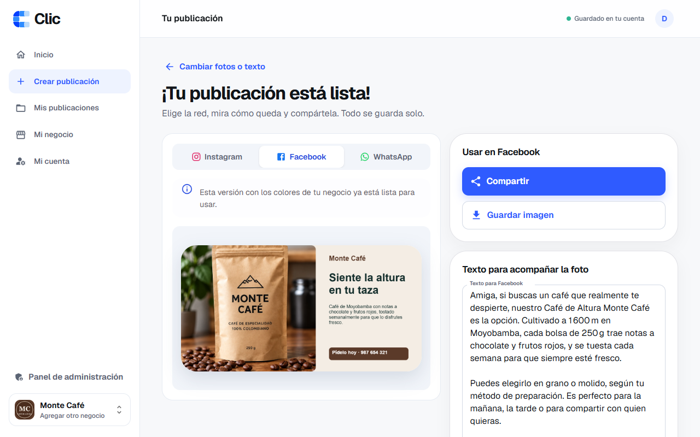
</p>

---

## Contenido

**Parte I · Visión general**
1. [El problema y la propuesta](#1-el-problema-y-la-propuesta)
2. [Recorrido por la aplicación](#2-recorrido-por-la-aplicación)
3. [Roles](#3-roles)
4. [Reglas de negocio](#4-reglas-de-negocio)

**Parte II · Documentación técnica**

5. [Guía de orientación: dónde está cada cosa](#5-guía-de-orientación-dónde-está-cada-cosa)
6. [Arquitectura](#6-arquitectura)
7. [Frontend](#7-frontend)
8. [Autenticación (Supabase Auth)](#8-autenticación-supabase-auth)
9. [Modelo de datos y almacenamiento](#9-modelo-de-datos-y-almacenamiento)
10. [Máquinas de estado](#10-máquinas-de-estado)
11. [Flujos de extremo a extremo](#11-flujos-de-extremo-a-extremo)
12. [Textos con IA (Groq y Grok)](#12-textos-con-ia-groq-y-grok)
13. [Referencia de la API](#13-referencia-de-la-api)
14. [Workflows de n8n](#14-workflows-de-n8n)
15. [Configuración](#15-configuración)
16. [Ejecución local](#16-ejecución-local)
17. [Guía de desarrollo](#17-guía-de-desarrollo)
18. [Solución de problemas](#18-solución-de-problemas)
19. [Seguridad y datos](#19-seguridad-y-datos)
20. [Decisiones, límites y deuda técnica](#20-decisiones-límites-y-deuda-técnica)

**Parte III · Presentación**

21. [Preguntas frecuentes](#21-preguntas-frecuentes)
22. [Demostración](#22-demostración)

---

# Parte I · Visión general

## 1. El problema y la propuesta

| Problema del emprendedor | Qué hace Clic |
|---|---|
| Diseñar cada publicación desde cero toma tiempo y exige saber de diseño. | Configura la marca **una vez** y cada publicación sale con su logo, colores, tono y contacto. |
| Cada red pide un tamaño distinto y terminan publicando la misma imagen recortada. | Genera **tres versiones** con el tamaño correcto: Instagram 1080 × 1080, Facebook 1200 × 630 y estado de WhatsApp 1080 × 1920. |
| Escribir un buen texto para redes cuesta; el que sale es corto o genérico. | La IA escribe un texto **por red** con la estructura de los posts que funcionan (gancho, historia, beneficios, datos y llamado a la acción), sin inventar datos. |
| Los formularios largos hacen que abandonen a la mitad. | Flujo de **tres pasos**: intención, producto y revisión. Lo demás viene de las preferencias. |
| Las piezas se pierden entre el celular y el chat. | **Mis publicaciones** guarda todo automáticamente, con búsqueda, filtros, duplicado y estado de cada red. |

**Alcance actual.** Es un prototipo funcional **local**: el estudio, el guardado y la redacción con IA funcionan de punta a punta; la generación de imágenes con IA y la publicación en redes dependen de workflows de n8n (ver [sección 14](#14-workflows-de-n8n)) y de las credenciales de Meta.

---

## 2. Recorrido por la aplicación

| | |
|---|---|
| 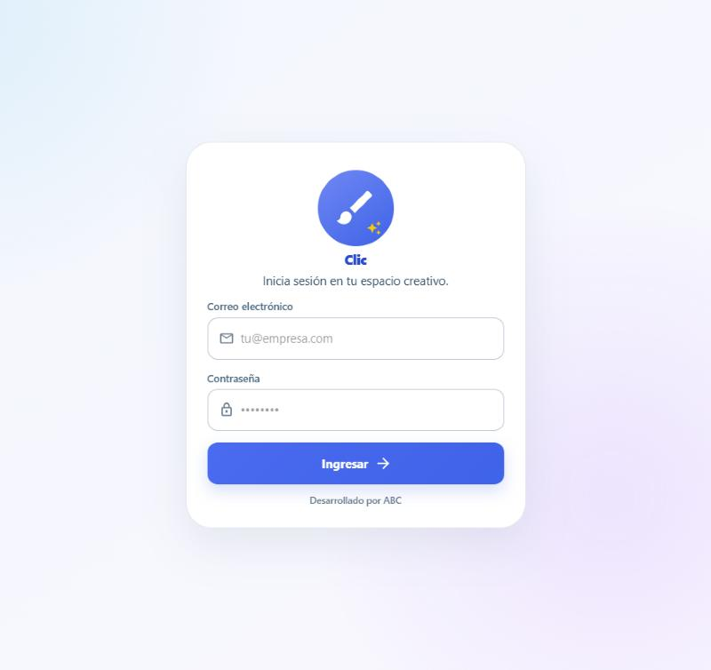 | 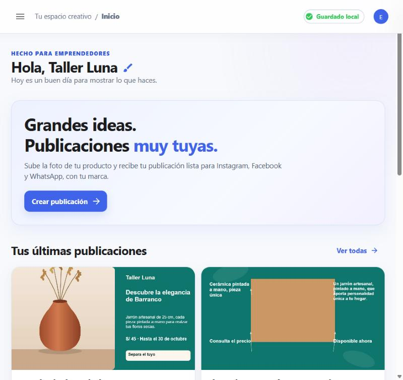 |
| **Inicio de sesión.** Correo y contraseña con Supabase Auth; también registro y recuperación de contraseña (ver [sección 8](#8-autenticación-supabase-auth)). | **Inicio.** Lo pendiente va primero (configurar el negocio o retomar lo que quedó a medias), el acceso a crear y las últimas publicaciones. |
| 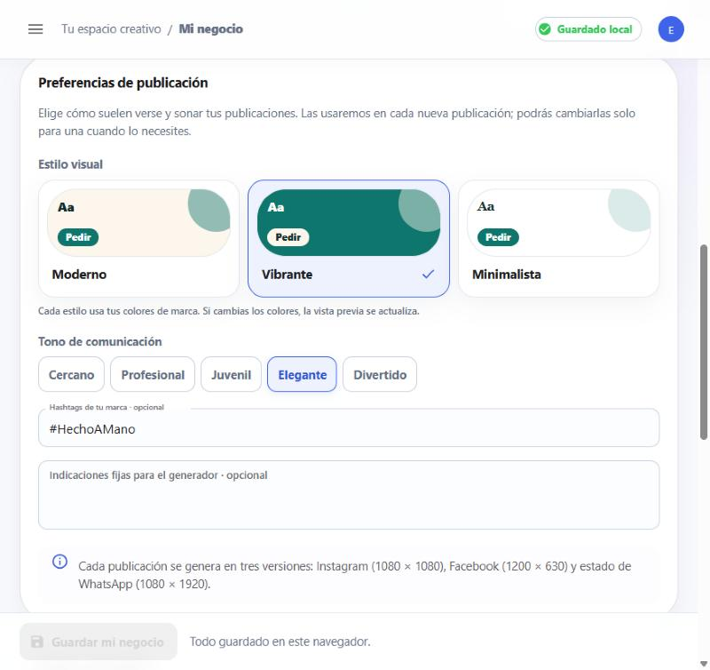 | 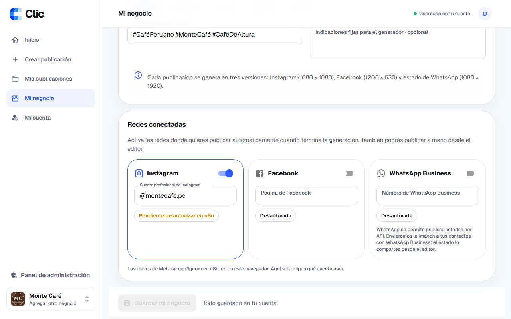 |
| **Mi negocio · Preferencias.** Estilo visual (pintado con los colores de la marca), tono, hashtags e indicaciones fijas para el generador. | **Mi negocio · Redes conectadas.** Cuenta de cada red y si se publica automáticamente al terminar la generación. |
| 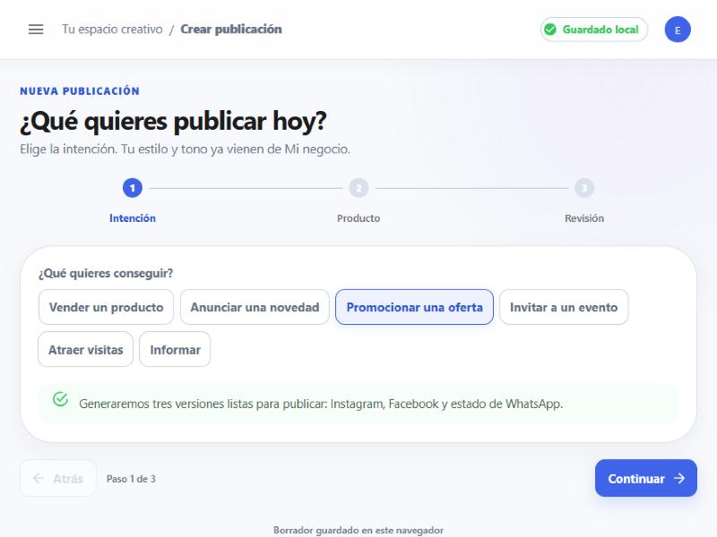 | 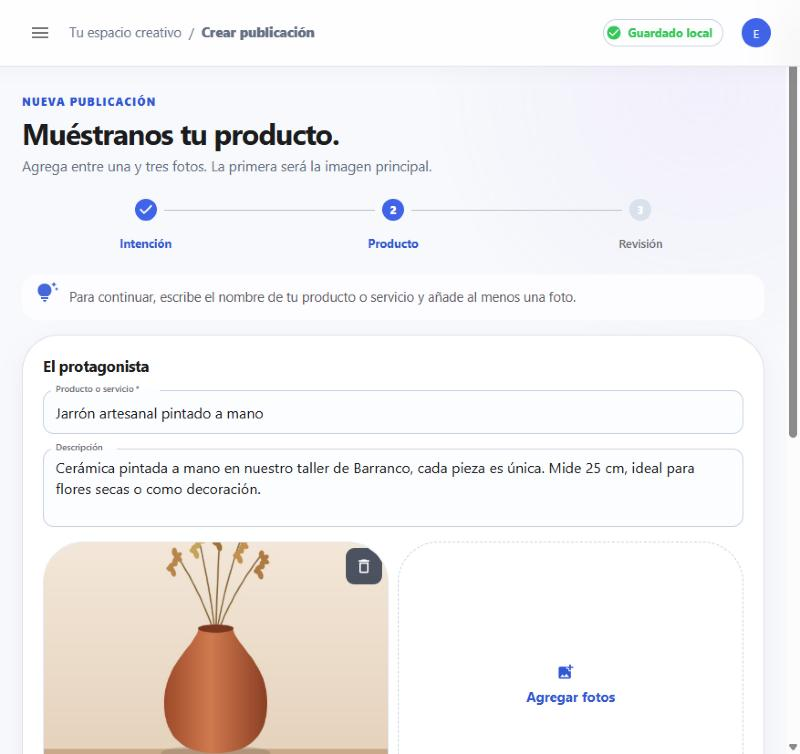 |
| **Paso 1 · Intención.** Vender, promocionar una oferta, anunciar una novedad, invitar a un evento, atraer visitas o informar. | **Paso 2 · Producto.** Nombre, descripción, de una a tres fotos, precio y vigencia. El contacto viene del negocio. |
| 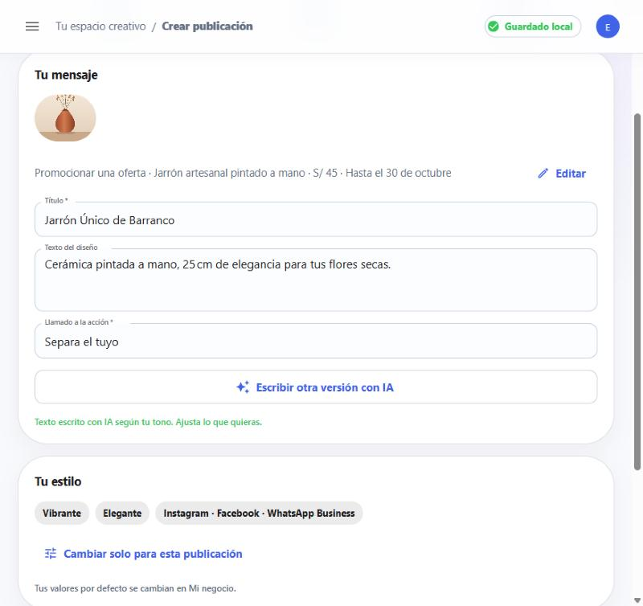 | 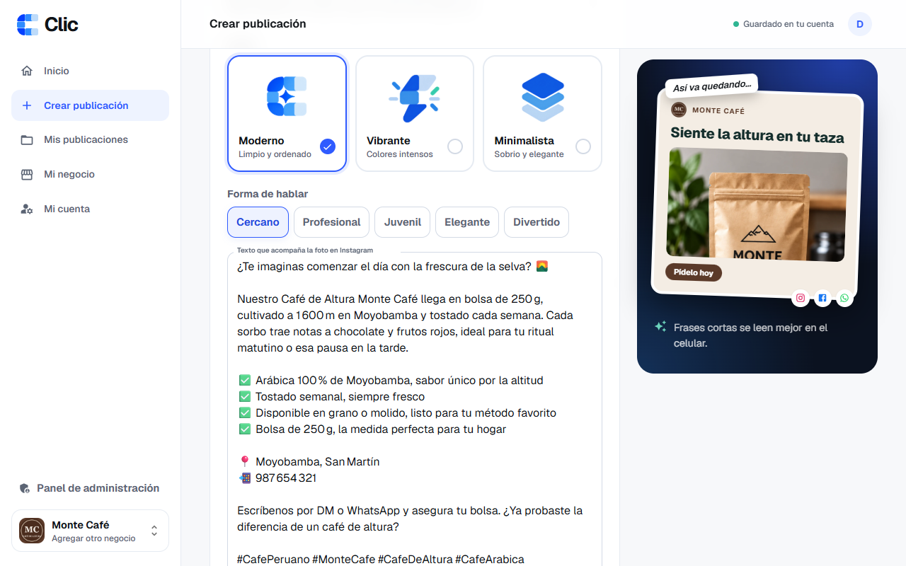 |
| **Paso 3 · Revisión.** Título, texto y llamado a la acción ya escritos por IA; se pueden reescribir o cambiar el estilo solo para esta publicación. | **Textos por red.** Instagram largo con beneficios y datos, Facebook conversacional y WhatsApp corto. |
| 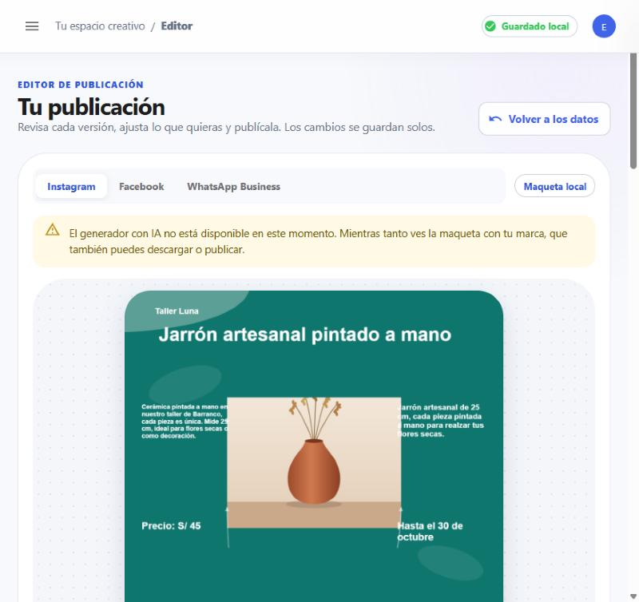 | 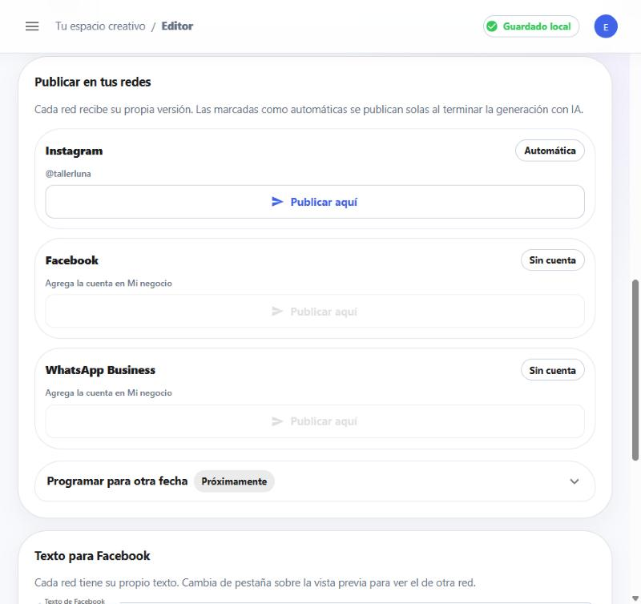 |
| **Editor.** Una pestaña por red; texto, imagen, estilo y posición editables. Si la IA de imágenes no está disponible, se muestra la maqueta con la marca. | **Publicar en tus redes.** Estado de cada red (automática, manual o sin cuenta) y publicación individual. |
| 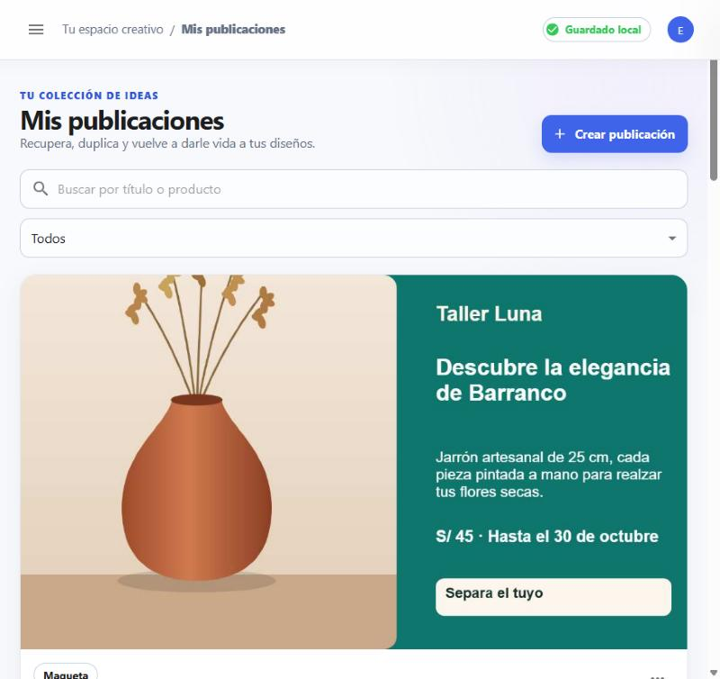 | 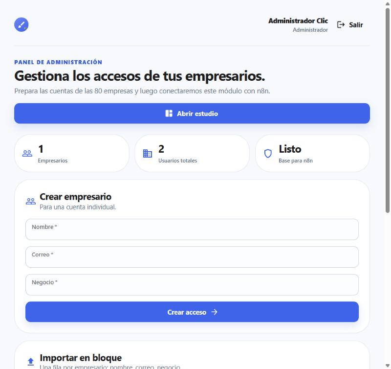 |
| **Mis publicaciones.** Todo lo creado o generado, con búsqueda y filtros (generadas con IA, maquetas, publicadas, con fecha). | **Administración.** Alta de empresarios uno a uno o en bloque (CSV). |

En el celular la interfaz se adapta a una columna y el menú pasa a un cajón lateral:

<p align="center">
  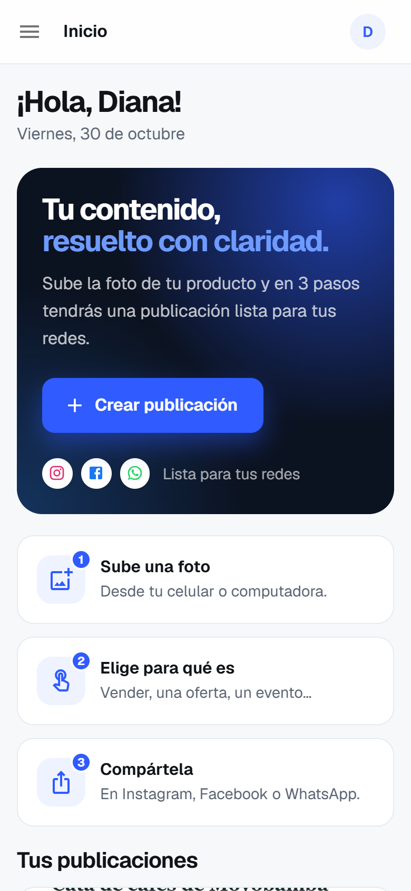
  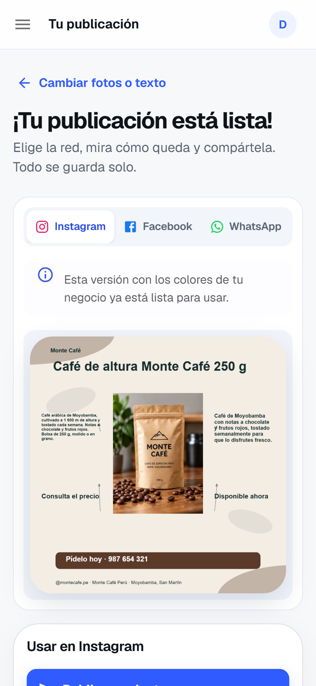
  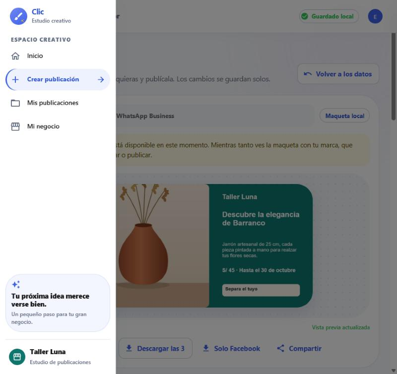
</p>

---

## 3. Roles

| Rol | Rol técnico (`AppUser.role`) | Puede |
|---|---|---|
| **Emprendedor** | `entrepreneur` | Configurar su negocio, crear, editar, descargar, compartir y publicar sus publicaciones. Solo ve sus propios datos. |
| **Administrador** | `admin` | Invitar emprendedores por correo (uno a uno o en bloque `nombre,correo,negocio`), cambiar roles, suspender y reactivar cuentas, ver la auditoría y abrir su propio estudio. |

Cada usuario puede tener **varios negocios**; cada negocio guarda su marca y sus publicaciones. Las políticas RLS de Postgres garantizan que nadie lea ni edite datos ajenos. Ver [sección 8](#8-autenticación-supabase-auth) y [9.3](#93-seguridad).

---

## 4. Reglas de negocio

| Regla | Detalle | Dónde se aplica |
|---|---|---|
| **Tres versiones por publicación** | `instagram` 1080 × 1080, `facebook` 1200 × 630, `whatsapp` 1080 × 1920. Los formatos antiguos (`portrait`, `story`) se conservan solo para abrir publicaciones viejas. | `networks`, `outputs`, `formats` en `src/lib/studio.ts` |
| **Para avanzar** | Paso 2: producto y al menos una foto. Paso 3: título y llamado a la acción. | `CreateFlow.tsx` (`valid`) |
| **Fotos** | De 1 a 3, JPG/PNG/WebP, máximo 8 MB cada una; se reducen a 1600 px (logo a 400 px) antes de guardarse. | `readPhoto()` en `studio-storage.ts`, `Photos` en `Fields.tsx` |
| **Intención** | Una sola elección que fija `type` y `objective` (los dos siguen viajando a n8n). | `intents` en `studio.ts` |
| **Preferencias** | Tono, estilo, hashtags e indicaciones se copian a cada publicación nueva; cambiarlas en una publicación no toca el perfil. | `newDesign()`, `normalizeBrand()` |
| **Estilo con colores de marca** | Moderno = principal sobre fondo; Vibrante = fondo con el color principal; Minimalista = fondo blanco y tipografía serif. | `styleLook()` |
| **Textos sin datos inventados** | La IA solo usa precio, vigencia, contacto, dirección y características escritas; prohíbe stock, envíos, descuentos o propiedades del material no indicadas. | Prompt en `copyMessages()` (`src/lib/copy.ts`) |
| **Límites de texto** | Diseño: título 80, texto 180, llamado 40 caracteres (la IA apunta a 60 / 160 / 30). Redes: Instagram 2200, Facebook 2000, WhatsApp 700. | `Field maxLength`, `copyLimits`, `captionLimits` |
| **Hashtags** | Instagram: todos (8–12); Facebook: los 3 primeros; WhatsApp: ninguno. Siempre se incluyen los de la marca. | `sanitizeCopy()` |
| **Todo se guarda** | Al pulsar *Crear publicación* la publicación entra a Mis publicaciones aunque falle la IA; luego los cambios se guardan solos (350 ms después de cada edición). | `generateWithN8n()` y efecto de autoguardado en `Studio.tsx` |
| **Publicación automática** | Solo al terminar una generación con IA y solo en las redes activadas **con cuenta**. A mano se puede publicar cualquier versión. | Efecto de finalización y `publish()` en `Studio.tsx` |
| **WhatsApp** | La API no publica estados: el workflow debe enviar la imagen a contactos que aceptaron recibirla; el estado se comparte a mano. | Texto en `BrandForm.tsx`; workflow pendiente |

---

# Parte II · Documentación técnica

## 5. Guía de orientación: dónde está cada cosa

### 5.1 Por tarea

| Quiero… | Mira en… |
|---|---|
| Entender cómo entra un usuario | `src/components/auth/AuthGate.tsx`, `AuthScreens.tsx`, `src/lib/auth.ts` → [sección 8](#8-autenticación-supabase-auth) |
| Cambiar tablas, permisos o RLS | `supabase/migrations/20261029000000_base.sql` → [sección 9](#9-modelo-de-datos-y-almacenamiento) |
| Proteger una ruta `/api` nueva | `requireUser()` y `audit()` en `src/lib/supabase/server.ts`; límites en `src/lib/rate-limit.ts` |
| Cambiar el panel de administración | `src/components/admin/AdminPanel.tsx` y `src/app/api/admin/users/route.ts` |
| Cambiar el menú o añadir una vista | `src/components/studio/Studio.tsx` (`View`, `nav`) |
| Cambiar los pasos de *Crear publicación* | `src/components/studio/CreateFlow.tsx` (`steps`, `titles`, `descriptions`) |
| Cambiar qué se guarda de cada publicación | Tipo `Design` y `newDesign()` en `src/lib/studio.ts` |
| Añadir una intención, tono o estilo | `intents`, `tones`, `styles`, `styleLook()` en `src/lib/studio.ts` |
| Cambiar el diseño de la maqueta (Canvas) | `src/lib/studio-renderer.ts` (`renderSocialLayout`) |
| Cambiar el prompt o las reglas de los textos con IA | `copyMessages()`, `copySchema`, `sanitizeCopy()` en `src/lib/copy.ts` |
| Cambiar el proveedor o modelo de IA de texto | `copyProviders` en `src/lib/copy.ts` o variables `GROQ_*` / `XAI_*` |
| Cambiar lo que se envía a n8n | `generationPayload()` y `publishPayload()` en `src/lib/studio.ts` |
| Cambiar el editor | `src/components/studio/Editor.tsx` |
| Cambiar Mi negocio | `src/components/studio/BrandForm.tsx` |
| Cambiar campos reutilizables (fotos, selector de estilo…) | `src/components/studio/Fields.tsx` |
| Cambiar el polling de la generación | `src/hooks/usePolling.ts` |
| Cambiar el tema visual (colores, tipografías de MUI) | `src/theme.ts` |
| Probar la lógica | `tests/studio.test.cjs`, `tests/copy.test.cjs`, `tests/security.test.cjs` (`npm test`) |

### 5.2 Mapa del repositorio

```text
proj-automatizacion/
├─ src/
│  ├─ app/
│  │  ├─ layout.tsx               Metadatos, proveedor de caché de MUI y tema
│  │  ├─ page.tsx                 Única página: renderiza AuthGate
│  │  ├─ globals.css              Estilos globales (Tailwind importado)
│  │  ├─ auth/callback/route.ts   Enlaces de correo de Supabase (confirmar, invitar, recuperar)
│  │  └─ api/                     Rutas del servidor (todas exigen sesión)
│  │     ├─ admin/users/route.ts        GET/POST/PATCH → cuentas (solo admin)
│  │     ├─ generate/route.ts           POST → webhook n8n de generación
│  │     ├─ generate/status/route.ts    GET  → webhook n8n de estado
│  │     ├─ copy/route.ts               POST → Groq / Grok (textos con IA)
│  │     └─ publish/route.ts            POST → webhook n8n de publicación
│  ├─ proxy.ts                    Renueva la sesión de Supabase en cada petición
│  ├─ components/
│  │  ├─ auth/AuthGate.tsx        Sesión, perfil, negocios y reparto por rol
│  │  ├─ auth/AuthScreens.tsx     Ingresar, registrarse, recuperar y elegir contraseña
│  │  ├─ admin/AdminPanel.tsx     Invitaciones, roles, suspensión y auditoría
│  │  ├─ studio/
│  │  │  ├─ Studio.tsx            Contenedor: menú, vistas, guardado, generación y publicación
│  │  │  ├─ AccountView.tsx       Mi cuenta: nombre, contraseña, negocios, actividad
│  │  │  ├─ CreateFlow.tsx        Crear publicación en 3 pasos
│  │  │  ├─ Editor.tsx            Editor por red, descargas, publicación
│  │  │  ├─ BrandForm.tsx         Mi negocio: identidad, contacto, preferencias, redes
│  │  │  └─ Fields.tsx            Field, Choices, Panel, Photos, StylePicker
│  │  ├─ brand/ClicLogo.tsx       Logo
│  │  ├─ theme/AppThemeProvider   Tema de MUI
│  │  └─ Step*.tsx, WizardLayout  (heredados, sin uso)
│  ├─ hooks/usePolling.ts         Consulta el estado de la generación cada 3 s
│  ├─ lib/
│  │  ├─ studio.ts                Modelo de datos, reglas y contratos (fuente de verdad)
│  │  ├─ copy.ts                  Proveedores de IA, prompt y validación de textos
│  │  ├─ studio-renderer.ts       Render de la maqueta en Canvas, descargas
│  │  ├─ studio-storage.ts        Negocio y publicaciones en Supabase, borrador en IndexedDB
│  │  ├─ media.ts                 data URL ↔ referencia de Storage ↔ URL firmada
│  │  ├─ auth.ts                  Perfil, negocios, auditoría y mensajes de Auth
│  │  ├─ rate-limit.ts            Límite de peticiones por usuario
│  │  └─ supabase/                Clientes de navegador, servidor y service role
│  ├─ store/useWizardStore.ts     (heredado, sin uso)
│  └─ theme.ts                    Paleta y tipografía
├─ supabase/migrations/           Esquema, RLS, triggers y Storage
├─ n8n/                           Workflows importables de generación de imágenes
├─ tests/                         Pruebas con node:test sobre src/lib
├─ docs/capturas/                 Capturas usadas en este README
├─ public/brand/                  Recursos del logo
└─ .env.example                   Plantilla de variables de entorno
```

### 5.3 Qué usa cada pantalla

| Pantalla | Datos y servicios |
|---|---|
| Inicio de sesión | Supabase Auth; `/auth/callback` para los enlaces de correo |
| Administración | `GET/POST/PATCH /api/admin/users`; `activity_log` |
| Inicio | `businesses`, `publications`; IndexedDB: `draft` |
| Mi negocio | `businesses.brand`; logo en Storage |
| Mi cuenta | `profiles`, `businesses`, `activity_log`; Supabase Auth (contraseña) |
| Crear publicación | IndexedDB: `draft`; `POST /api/copy`; al crear, `publications` y `POST /api/generate` |
| Editor | IndexedDB: `draft`; `publications`; Storage; Canvas; `GET /api/generate/status`; `POST /api/copy`; `POST /api/publish` |
| Mis publicaciones | `publications`; imágenes con URLs firmadas de Storage |

---

## 6. Arquitectura

### 6.1 Contexto del sistema

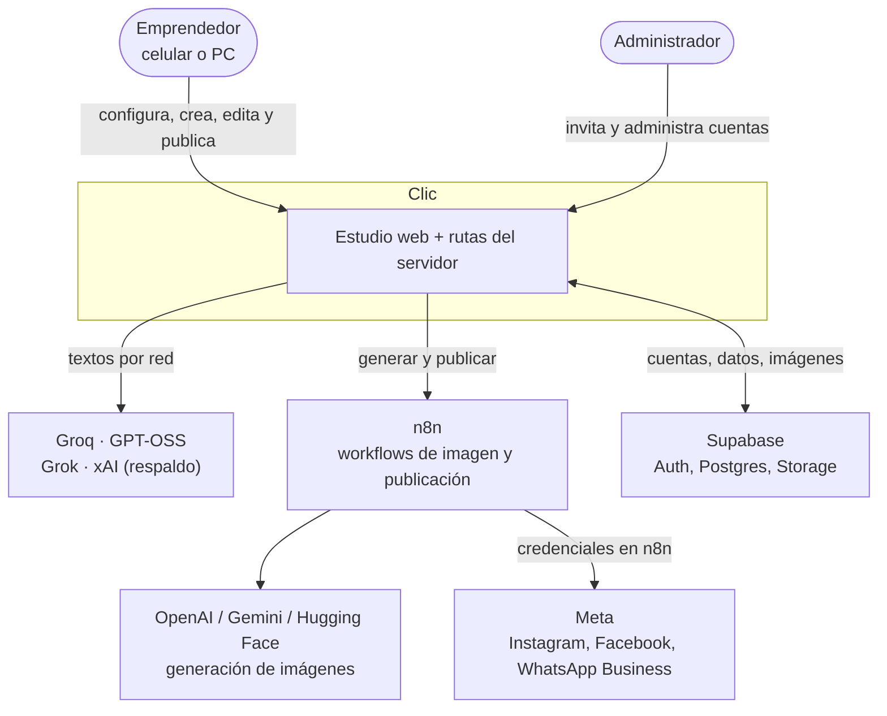

### 6.2 Contenedores y responsabilidades

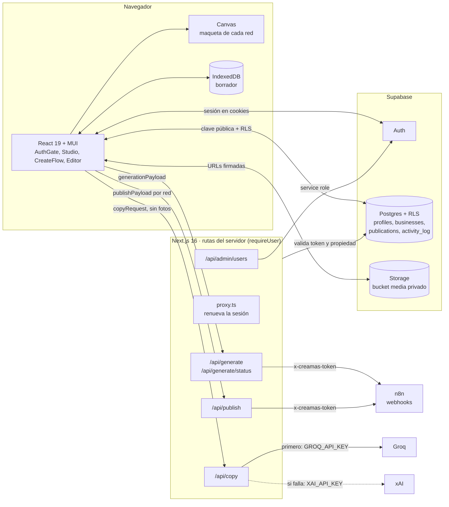

**Regla de oro.** El navegador **nunca** habla directo con n8n, Groq, xAI ni Meta. Las rutas del servidor guardan las URL y claves en variables de entorno y devuelven mensajes de error en lenguaje claro.

| Camino | Qué pasa por ahí | Quién guarda el secreto |
|---|---|---|
| Navegador ↔ Supabase (Auth, Postgres, Storage) | Sesión, perfil, negocios, publicaciones e imágenes; RLS filtra por usuario | Clave pública en el navegador; `SUPABASE_SERVICE_ROLE_KEY` solo en el servidor |
| Navegador ↔ IndexedDB | Borrador en curso | — (dispositivo) |
| Navegador → `/api/copy` → Groq / xAI | Datos del producto y del negocio, sin fotos | `GROQ_API_KEY`, `XAI_API_KEY` en el servidor |
| Navegador → `/api/generate` → n8n | Diseño completo; fotos guardadas como URLs firmadas | `N8N_WEBHOOK_TOKEN` en el servidor |
| Navegador → `/api/publish` → n8n → Meta | Una imagen y su texto por red | Token de n8n en el servidor; credenciales de Meta **solo en n8n** |

### 6.3 Ejecución actual (local)

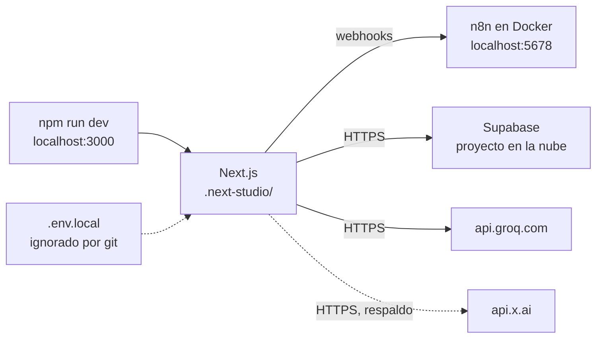

No hay despliegue de producción todavía. La compilación usa `distDir: '.next-studio'` (ver `next.config.mjs`).

---

## 7. Frontend

### 7.1 Estructura de componentes

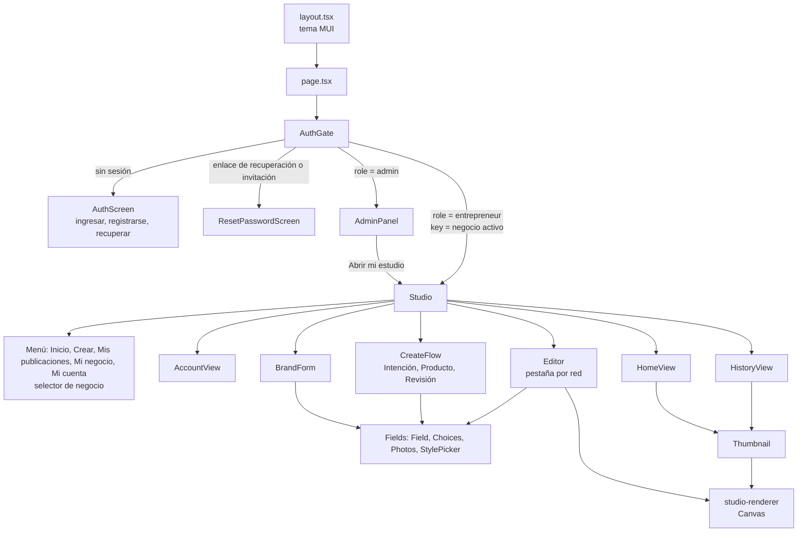

### 7.2 Decisiones de implementación

| Tema | Decisión |
|---|---|
| **Una sola página** | `page.tsx` renderiza `AuthGate`; `Studio` cambia de vista con estado (`view`), sin rutas por URL. Simple, pero no hay enlaces directos a una vista. |
| **Fuente de verdad en `lib/`** | Modelo, reglas y contratos en `studio.ts`; textos con IA en `copy.ts`. Los componentes solo los usan, y las pruebas cubren esos módulos. |
| **Autoguardado** | Cada cambio del borrador se guarda en IndexedDB a los 350 ms; si la publicación ya está en el historial, también se actualiza ahí. `patchDesign()` aplica cambios asíncronos (generación, publicación) sin pisar ediciones posteriores. |
| **Maqueta en Canvas** | La vista previa y la descarga usan el mismo renderizador (`renderDesign`), así que lo que se ve es lo que se descarga. |
| **Diseño adaptable** | MUI con puntos de quiebre `sm`/`md`/`lg`; cuadrículas con `minmax(0, 1fr)` para que nada desborde en 375 px; menú lateral fijo en escritorio y cajón en celular. |
| **Mensajes claros** | Errores de red y de servicios externos traducidos a frases sin jerga ("El generador con IA no está disponible en este momento"). |

### 7.3 Patrones que se repiten

- **`update(patch)`**: cada vista recibe una función que mezcla cambios en el borrador y actualiza `updatedAt`.
- **`notify(mensaje, error?)`**: avisos temporales (`Snackbar`) que `Studio` muestra.
- **`Panel`, `Field`, `Choices`**: contenedores y campos con el mismo estilo en toda la app (`Fields.tsx`).

---

## 8. Autenticación (Supabase Auth)

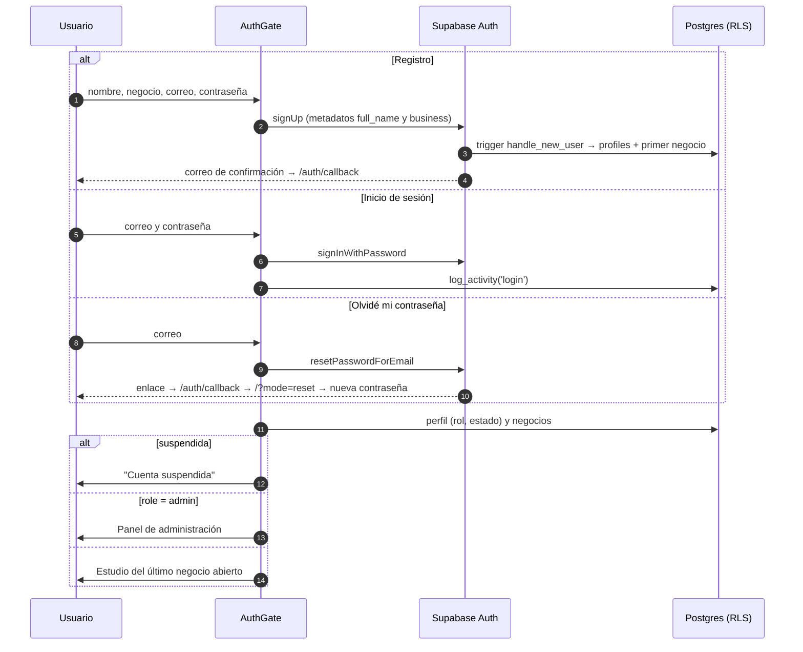

| Pieza | Archivo | Qué hace |
|---|---|---|
| Pantallas de acceso | `src/components/auth/AuthScreens.tsx` | Ingresar, registrarse, recuperar contraseña y elegir contraseña (recuperación e invitación). |
| Puerta de entrada | `src/components/auth/AuthGate.tsx` | Lee la sesión, el perfil y los negocios; decide qué pantalla mostrar. |
| Enlaces de correo | `src/app/auth/callback/route.ts` | Canjea `token_hash` o `code` por una sesión. Solo redirige a rutas internas. |
| Renovación de sesión | `src/proxy.ts` | Refresca el token en cada petición (en Next 16, `proxy` reemplaza a `middleware`). |
| Clientes | `src/lib/supabase/{client,server,env}.ts` | Navegador (cookies), servidor y `service role` (solo servidor). |
| Guardia de API | `requireUser()` en `server.ts` | Valida el token con Supabase (`getUser`), exige cuenta activa y, si se pide, rol admin. |

- **Contraseñas**: mínimo 8 caracteres, con letras y números (`passwordProblem`). Supabase las guarda con hash; la app nunca las ve en texto plano.
- **Invitaciones**: el administrador invita desde el panel (`POST /api/admin/users`). La persona recibe un correo, entra a `/?mode=welcome` y elige su contraseña. Ya no hay contraseñas temporales.
- **Suspensión**: `PATCH /api/admin/users` marca el perfil como `suspended` **y** banea el usuario en Auth. RLS deja de devolverle datos aunque su token siga vigente unos minutos.
- **Google**: "Continuar con Google" llama a `signInWithOAuth` y vuelve a `/auth/callback?provider=google`, que canjea el código, registra el login y entra al estudio. La primera vez el trigger `handle_new_user` crea el perfil con el nombre de Google y un negocio "Mi negocio". Si la persona cancela, ve un aviso y puede entrar con su correo. Una cuenta con el mismo correo se une a la existente.

#### Activar Google

1. **Google Cloud Console** → APIs y servicios → Pantalla de consentimiento de OAuth: tipo *Externo*, nombre "Clic", logo y correo de soporte.
2. **Credenciales → Crear credenciales → ID de cliente de OAuth** → *Aplicación web*.
   - Orígenes autorizados de JavaScript: `http://localhost:3005` y la URL de producción.
   - URI de redireccionamiento autorizados: `https://<tu-proyecto>.supabase.co/auth/v1/callback`.
3. **Supabase** → Authentication → Sign In / Providers → Google: actívalo y pega el *Client ID* y el *Client Secret*.
4. **Supabase** → Authentication → URL Configuration: agrega `http://localhost:3005/auth/callback` y la de producción a *Redirect URLs*.
5. En `.env.local`: `NEXT_PUBLIC_GOOGLE_AUTH=true` y reinicia `npm run dev`.

## 9. Modelo de datos y almacenamiento

### 9.1 Base de datos (Postgres en Supabase)

El esquema completo está en `supabase/migrations/20261029000000_base.sql`.

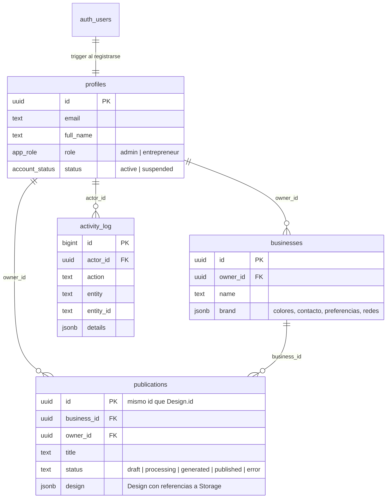

- **Varios negocios por usuario**: cada negocio tiene su marca y sus publicaciones. Se cambia desde el pie del menú lateral; el último abierto se recuerda por usuario.
- `Design` se guarda entero en `publications.design`; `title` y `status` se copian a columnas para listar y filtrar sin abrir el JSON.
- Los tipos `Brand`, `Design`, `Generation` y `Publication` siguen en `src/lib/studio.ts`.

### 9.2 Imágenes (Supabase Storage)

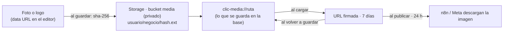

- `src/lib/studio-storage.ts` mantiene la misma interfaz que antes (`storage.get/put` de `brand`, `draft` y `history`), pero `brand` e `history` van a Supabase y solo se suben las publicaciones que cambiaron.
- El **borrador en curso** sigue en IndexedDB del dispositivo (se guarda cada 350 ms y aguanta cortes de red). Al abrirlo se vuelven a firmar sus imágenes.
- Una imagen idéntica no se sube dos veces: la ruta es el hash del contenido.
- La conversión entre data URL, referencia y URL firmada está en `src/lib/media.ts` y tiene pruebas.

### 9.3 Seguridad

| Capa | Qué protege |
|---|---|
| RLS en las 4 tablas | Cada usuario ve y edita solo lo suyo; el admin puede leer todo. `anon` no tiene acceso. |
| `is_active()` en las políticas | Una cuenta suspendida no lee ni escribe nada. |
| Trigger `protect_profile` | Un usuario no puede cambiarse el rol, el estado ni el correo. |
| Políticas de Storage | Solo se sube y se lee dentro de la carpeta `<tu-id>/`. Solo PNG, JPG y WebP, máximo 10 MB. |
| `requireUser()` en `/api/*` | Sin sesión válida: 401. Suspendida: 403. Admin: 403 si no lo es. |
| Propiedad en `/api/generate` y `/api/publish` | La publicación debe existir y ser del usuario (consulta con RLS). |
| Límite por usuario (`src/lib/rate-limit.ts`) | Textos 30, generaciones 10 y publicaciones 30 cada 10 min; invitaciones 200 por hora. |
| Auditoría (`activity_log`) | Triggers registran altas, bajas, cambios de estado y de rol; la app registra inicio de sesión, generación y publicación. Nadie puede escribirla ni borrarla desde el cliente. |
| Cabeceras HTTP | `X-Frame-Options`, `nosniff`, `Referrer-Policy`, `Permissions-Policy`, HSTS (`next.config.mjs`). |
| Secretos | `SUPABASE_SERVICE_ROLE_KEY`, claves de IA y token de n8n viven solo en el servidor. |

Se eliminó `/api/upload`, que firmaba subidas públicas a DigitalOcean Spaces sin pedir sesión.

### 9.4 Puesta en marcha de Supabase

1. Crea un proyecto en [supabase.com](https://supabase.com) y abre **SQL Editor**. Pega y ejecuta `supabase/migrations/20261029000000_base.sql`.
2. En **Project Settings → API** copia la URL, la `anon`/publishable key y la `service_role` key a `.env.local` (ver `.env.example`).
3. En **Authentication → URL Configuration** pon como *Site URL* la dirección de la app (en local, `http://localhost:3005`) y agrega `http://localhost:3005/auth/callback` a *Redirect URLs*.
4. En **Authentication → Email Templates** cambia el enlace de cada plantilla para que funcione aunque se abra en otro navegador:
   - Confirm signup: `{{ .SiteURL }}/auth/callback?token_hash={{ .TokenHash }}&type=signup`
   - Invite user: `{{ .SiteURL }}/auth/callback?token_hash={{ .TokenHash }}&type=invite`
   - Reset password: `{{ .SiteURL }}/auth/callback?token_hash={{ .TokenHash }}&type=recovery`
5. Regístrate en la app y conviértete en administrador desde el SQL Editor:
   `update public.profiles set role = 'admin' where email = 'tu-correo@ejemplo.com';`
6. Para producción, configura un SMTP propio en **Authentication → SMTP**: el correo incluido de Supabase envía muy pocos mensajes por hora.
7. Comprueba la seguridad contra el proyecto real con `npm run check:rls`: crea dos cuentas temporales, intenta 21 accesos indebidos (datos, Storage, auditoría, rol de admin, cuenta suspendida) y las borra al terminar.

Para probar la app sin enviar correos, `node scripts/test-user.mjs create [admin]` crea una cuenta ya confirmada (sus datos quedan en `.env.test.local`, ignorado por git) y `node scripts/test-user.mjs delete` la borra con todo lo suyo.

---

## 10. Máquinas de estado

### 10.1 Generación de imágenes con IA (`Design.generation`)

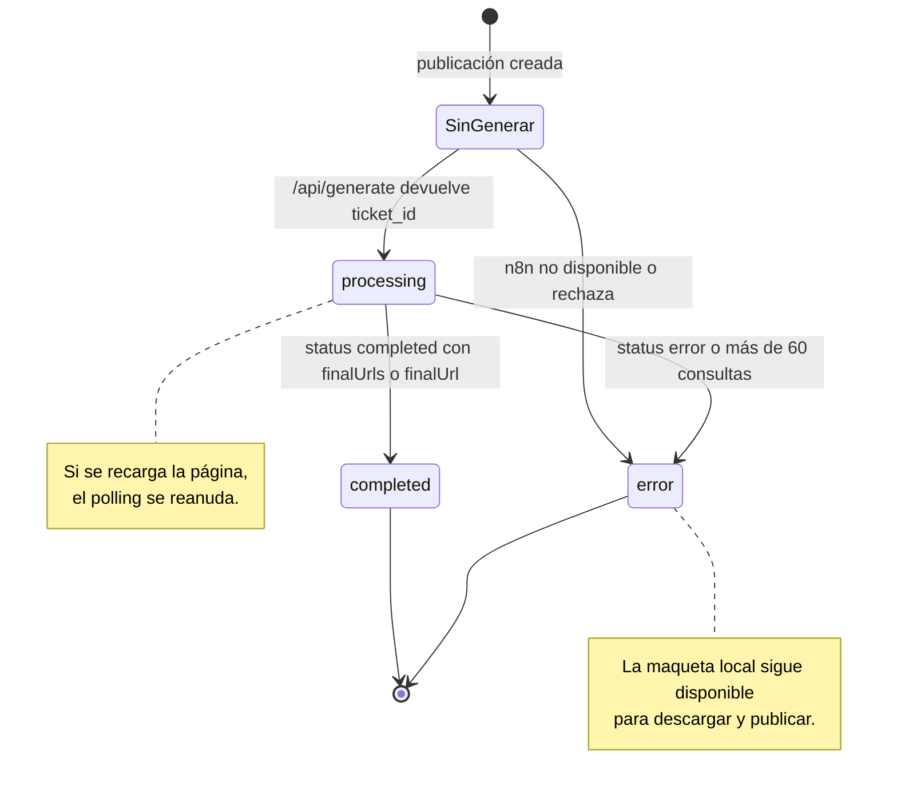

### 10.2 Publicación por red (`Design.publications[red]`)

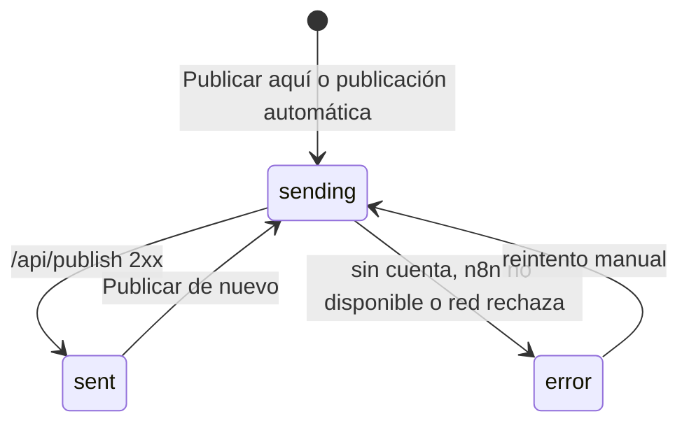

### 10.3 Flujo de creación

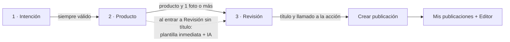

---

## 11. Flujos de extremo a extremo

### 11.1 Crear una publicación

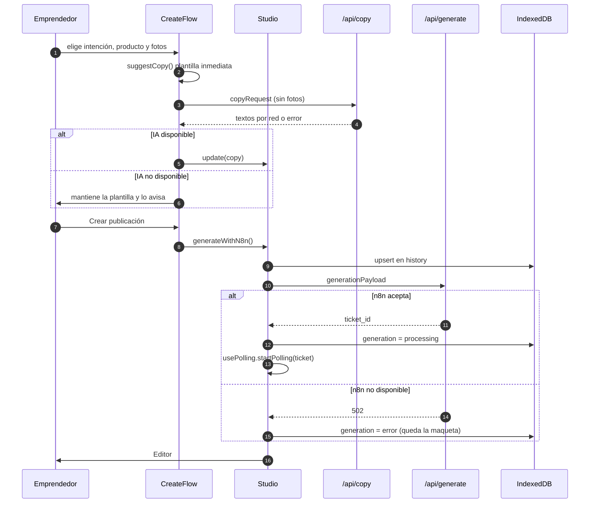

### 11.2 Generación de imágenes y publicación automática

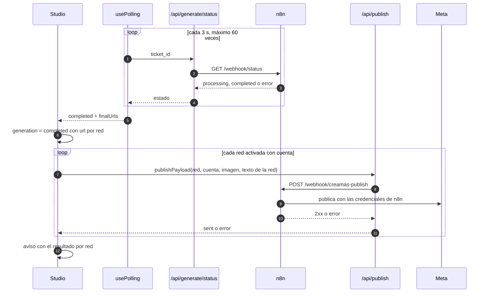

### 11.3 Descargar y compartir

- **Descargar las 3**: por cada red usa la imagen generada si existe; si no, renderiza la maqueta con `renderDesign({ ...design, format: red })` y descarga un PNG.
- **Solo [red]**: descarga la vista previa actual.
- **Compartir**: usa Web Share con archivos cuando el navegador lo permite; si no, descarga la imagen y explica cómo enviarla.

---

## 12. Textos con IA (Groq y Grok)

Los textos se escriben con un modelo de texto **aparte del generador de imágenes**: una versión nueva de texto no gasta créditos de imagen.

### 12.1 Proveedores

| Orden | Proveedor | Clave | Modelo por defecto | Notas |
|---|---|---|---|---|
| 1 | **Groq** | `GROQ_API_KEY` | `openai/gpt-oss-120b` (`GROQ_MODEL`) | Plan gratuito con límites diarios (confirmar en la consola de Groq). Se pide razonamiento bajo para gastar menos tokens. |
| 2 | **Grok (xAI)** | `XAI_API_KEY` | `grok-4.20-0309-non-reasoning` (`XAI_MODEL`) | De pago; solo se usa si tiene clave y Groq falla. |
| 3 | **Plantillas** | — | `suggestCopy()` | Sin claves o si ambos fallan. |

`COPY_PROVIDER=xai` invierte el orden. `GROQ_API_URL` y `XAI_API_URL` permiten apuntar a otro servidor compatible (útil para pruebas).

### 12.2 Pipeline

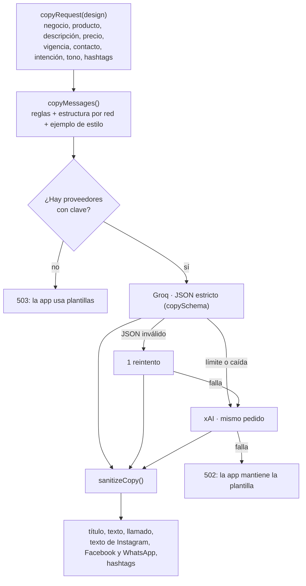

### 12.3 Qué pide el prompt

| Campo | Indicación |
|---|---|
| `title`, `body`, `cta` | Cortos, para imprimir sobre la imagen (3–8 palabras; 1–2 frases; verbo en imperativo). |
| `instagram` | 150–220 palabras: gancho → historia del producto → 4–5 beneficios con emoji → datos (💰 🗓️ 📍 📲 solo si existen) → llamado a la acción → pregunta para comentarios. |
| `facebook` | 90–140 palabras, conversacional, 3–4 párrafos. |
| `whatsapp` | 30–60 palabras, 3–4 líneas, cierra con "Respóndeme este estado" o "Escríbeme". |
| `hashtags` | 8–12 en CamelCase, siempre con los de la marca. |
| Regla de oro | Nunca inventar precios, fechas, stock, envíos, descuentos, medios de pago ni propiedades del material. |

`sanitizeCopy()` recorta a los límites, quita markdown y hashtags sueltos, deja como máximo una línea en blanco seguida y añade los hashtags según la red.

---

## 13. Referencia de la API

Todas las rutas están en `src/app/api/`, reciben y devuelven JSON y responden errores como `{ "error": "mensaje claro" }`.

### 13.1 `POST /api/copy` — escribir textos

Cuerpo (`copyRequest`):

```json
{
  "business": "Taller Luna",
  "product": "Jarrón artesanal pintado a mano",
  "description": "Cerámica pintada a mano… Mide 25 cm…",
  "price": "S/ 45",
  "validity": "Hasta el 30 de octubre",
  "contact": "",
  "intent": "Promocionar una oferta",
  "tone": "Elegante",
  "brandHashtags": "#HechoAMano",
  "instagram": "@tallerluna",
  "address": "",
  "avoid": ""
}
```

| Código | Respuesta |
|---|---|
| `200` | `{ copy: { title, body, cta, hashtags, caption, captions: { instagram, facebook, whatsapp } }, provider, model }` |
| `400` | Cuerpo inválido o sin `product` |
| `502` | Todos los proveedores fallaron o tardaron más de 25 s por intento |
| `503` | No hay `GROQ_API_KEY` ni `XAI_API_KEY` |

### 13.2 `POST /api/generate` — iniciar generación de imágenes

Reenvía `generationPayload(design)` a `N8N_GENERATE_WEBHOOK_URL` (15 s de espera) con la cabecera `x-creamas-token` si existe `N8N_WEBHOOK_TOKEN`.

```json
{
  "version": 1,
  "requestId": "uuid",
  "business": { "name": "Taller Luna", "logo": "data:…", "primary": "#0f766e", "secondary": "#fdf6ec", "preferences": { "tone": "Elegante", "style": "Vibrante", "hashtags": "#HechoAMano", "instructions": "" } },
  "product": { "name": "…", "description": "…", "price": "S/ 45", "images": ["data:image/jpeg;base64,…"] },
  "content": {
    "type": "Oferta", "objective": "Promocionar una oferta",
    "format": "instagram", "dimensions": { "label": "Instagram · cuadrado", "width": 1080, "height": 1080 },
    "outputs": [
      { "network": "instagram", "width": 1080, "height": 1080 },
      { "network": "facebook", "width": 1200, "height": 630 },
      { "network": "whatsapp", "width": 1080, "height": 1920 }
    ],
    "style": "Vibrante", "colors": { "primary": "#fdf6ec", "background": "#0f766e" },
    "tone": "Elegante", "instructions": "", "validity": "…", "contact": "…"
  },
  "copy": { "title": "…", "body": "…", "cta": "…", "hashtags": "…", "caption": "…", "captions": { "instagram": "…", "facebook": "…", "whatsapp": "…" } },
  "edits": [],
  "schedule": null
}
```

| Código | Respuesta |
|---|---|
| `200` | `{ ticket_id, … }` (acepta también `ticketId` o `requestId` de n8n) |
| `400` | Falta `requestId` o `product` |
| `502` | n8n no responde, rechaza o no devuelve ticket |

### 13.3 `GET /api/generate/status?ticket_id=…` — estado

Consulta `N8N_STATUS_WEBHOOK_URL` (10 s). Respuesta esperada de n8n:

```json
{ "status": "completed", "finalUrls": { "instagram": "https://…", "facebook": "https://…", "whatsapp": "https://…" } }
```

También acepta `finalUrl`, `final_url`, `imageUrl` o `image_url` (una sola imagen, que se usa para las tres redes). `status` puede ser `processing`, `completed` o `error`.

### 13.4 `POST /api/publish` — publicar en una red

Cuerpo (`publishPayload`), una llamada por red; se reenvía a `N8N_PUBLISH_WEBHOOK_URL` (30 s):

```json
{
  "version": 1,
  "requestId": "uuid",
  "network": "instagram",
  "account": "@tallerluna",
  "image": "https://… o data:image/png;base64,…",
  "dimensions": { "label": "Instagram · cuadrado", "width": 1080, "height": 1080 },
  "caption": "Texto propio de Instagram…",
  "business": "Taller Luna"
}
```

| Código | Respuesta |
|---|---|
| `200` | `{ …respuesta de n8n, status: "sent" }` |
| `400` | Red inválida o falta `requestId`, `image` o `account` |
| `502` | n8n no responde, responde error o `{ "status": "error" }` |

### 13.5 `/api/admin/users` — cuentas (solo administradores)

| Método | Cuerpo | Hace |
|---|---|---|
| `GET` | — | Lista perfiles con su número de negocios y publicaciones. |
| `POST` | `{ users: [{ name, email, business }] }` (máx. 200) | Envía invitaciones por correo. Responde `{ invited, skipped }`. |
| `PATCH` | `{ id, role?, status? }` | Cambia el rol o suspende/reactiva (también banea en Auth). No permite cambiarse a uno mismo. |

**Todas las rutas `/api`** responden `401` sin sesión, `403` si la cuenta está suspendida (o no es admin en esta ruta) y `429` al superar el límite por usuario. `/api/generate` y `/api/publish` además responden `404` si la publicación no es del usuario, y envían a n8n `owner: { userId, businessId }`.

---

## 14. Workflows de n8n

La carpeta `n8n/` contiene tres variantes importables del workflow de **generación**. Todas exponen `POST /webhook/creamas-generate` (responde un `ticket_id` al instante) y `GET /webhook/status` (consulta el trabajo).

| Archivo | Análisis y prompt | Imagen | Cuándo usarlo |
|---|---|---|---|
| `creamas-openai-images.json` | OpenAI Vision + agente con `gpt-4.1-mini` | OpenAI `images/edits` sobre la foto de referencia | Mejor calidad; requiere `OPENAI_API_KEY` en el contenedor de n8n |
| `creamas-web-images.json` | OpenAI Vision + agente con `gpt-4.1-mini` | Gemini (Nano Banana) | Alternativa con Gemini para la imagen |
| `creamas-free-images.json` | Gemini 1.5 Flash | Hugging Face `instruct-pix2pix` | Pruebas sin costo, menor calidad |

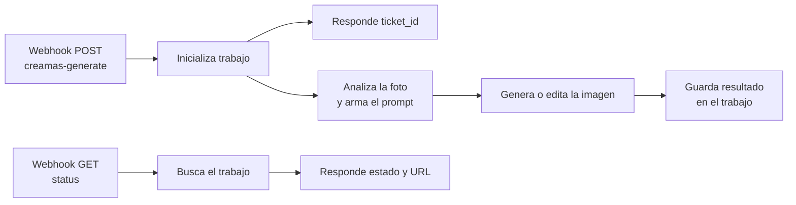

**Pendientes en n8n** (la app ya está lista para ellos):

1. Generar las **tres salidas** de `content.outputs` y devolver `finalUrls`. Hoy los workflows devuelven una sola imagen.
2. Crear el workflow **`creamas-publish`** con las credenciales de Meta: Instagram Graph API (`instagram_content_publish`, cuenta profesional vinculada a una página), Facebook Pages (`pages_manage_posts`) y WhatsApp Cloud API (mensaje con imagen a contactos que aceptaron recibirlo).
3. Validar la cabecera `x-creamas-token` en cada webhook.

Para importar: en n8n, *Import from file* → activar el workflow → conectar las credenciales indicadas en cada nodo. Las claves se configuran en n8n, nunca en los JSON ni en el frontend.

---

## 15. Configuración

Copia `.env.example` como `.env.local` (ignorado por git) y reinicia `npm run dev` después de cada cambio.

| Variable | Obligatoria | Para qué |
|---|---|---|
| `NEXT_PUBLIC_SUPABASE_URL` | **sí** | URL del proyecto de Supabase |
| `NEXT_PUBLIC_SUPABASE_ANON_KEY` | **sí** | Clave pública (`anon` o *publishable*); RLS decide qué puede ver |
| `SUPABASE_SERVICE_ROLE_KEY` | para el panel admin | Invitar y suspender cuentas. Solo servidor: nunca con prefijo `NEXT_PUBLIC_` |
| `GROQ_API_KEY` | recomendada | Textos con IA (plan gratuito) |
| `GROQ_MODEL` | no | Por defecto `openai/gpt-oss-120b`; `openai/gpt-oss-20b` es más rápido |
| `XAI_API_KEY` | no | Textos con Grok como respaldo |
| `XAI_MODEL` | no | Por defecto `grok-4.20-0309-non-reasoning` |
| `COPY_PROVIDER` | no | `groq` o `xai` para forzar cuál va primero |
| `GROQ_API_URL`, `XAI_API_URL` | no | Otro endpoint compatible (pruebas) |
| `N8N_GENERATE_WEBHOOK_URL` | para imágenes | Por defecto `http://localhost:5678/webhook/creamas-generate` |
| `N8N_STATUS_WEBHOOK_URL` | para imágenes | Por defecto `http://localhost:5678/webhook/status` |
| `N8N_PUBLISH_WEBHOOK_URL` | para publicar | Por defecto `http://localhost:5678/webhook/creamas-publish` |
| `N8N_WEBHOOK_TOKEN` | recomendada | Se envía como `x-creamas-token`; n8n debe validarlo |

> Sin Supabase la app muestra una pantalla de "Falta configurar Supabase" (ver [9.4](#94-puesta-en-marcha-de-supabase)). Sin las demás variables funciona igual: textos con plantillas, maqueta en lugar de imagen con IA y publicación desactivada.

---

## 16. Ejecución local

Requisitos: **Node.js ≥ 24.15** (`.nvmrc` indica 24.21.0) y, para imágenes y publicación, n8n en Docker.

```bash
npm install
cp .env.example .env.local   # completa las claves que tengas
npm run dev                  # http://localhost:3000
```

| Comando | Qué hace |
|---|---|
| `npm run dev` | Servidor de desarrollo (Turbopack) |
| `npm run build` | Compilación de producción con comprobación de tipos |
| `npm start` | Sirve la compilación |
| `npm run lint` | ESLint |
| `npm test` | Pruebas de `tests/*.test.cjs` (node:test) |

Si el `npm` global de Windows falla, los ejecutables locales funcionan directo:

```bash
node node_modules/next/dist/bin/next dev
node node_modules/typescript/bin/tsc --noEmit --incremental false
node --test tests/studio.test.cjs tests/copy.test.cjs
```

> Este proyecto usa **Next.js 16**, con cambios respecto a versiones anteriores. Antes de tocar convenciones del framework, revisa `node_modules/next/dist/docs/` (ver `AGENTS.md`).

---

## 17. Guía de desarrollo

### 17.1 Convenciones

- **Reglas en `src/lib/`**, no en los componentes. Todo cambio de modelo o contrato pasa por `studio.ts` o `copy.ts` y lleva su prueba.
- **Secretos solo en el servidor.** Cualquier servicio externo nuevo se llama desde una ruta en `src/app/api/`, nunca desde el navegador.
- **Contratos compatibles.** Al ampliar `generationPayload` o `publishPayload`, añadir campos sin quitar los existentes (n8n puede depender de ellos).
- **Textos al usuario en español claro**, sin nombres de servicios ni jerga técnica.
- **Diseño adaptable:** columnas de cuadrícula con `minmax(0, …)` y prueba en 375 px.

### 17.2 Recetas

**Una intención nueva**
1. Añadirla a `intents` en `studio.ts` con su `type` y `objective`.
2. Si cambia el llamado a la acción, ajustar `suggestCopy()`.

**Una red nueva**
1. Añadir su formato en `formats` y su entrada en `networks` (la clave debe coincidir).
2. Añadir su límite en `captionLimits`, su campo en `copySchema` y sus instrucciones en `copyMessages()`.
3. Añadirla a `NETWORKS` en `src/app/api/publish/route.ts` y su icono en `BrandForm.tsx`.
4. Revisar el diseño en `studio-renderer.ts` para su proporción.

**Un proveedor de IA de texto nuevo** (compatible con el formato de chat de OpenAI)
1. Añadirlo a `copyProviders` con `url`, `keyEnv`, `model` y `extra`.
2. Documentar su variable en `.env.example` y en la [sección 15](#15-configuración).

**Un campo nuevo en la publicación**
1. Añadirlo al tipo `Design` y a `newDesign()` con un valor por defecto.
2. Si debe llegar a n8n, añadirlo a `generationPayload()`.
3. Si `duplicateDesign()` no debe copiarlo, reiniciarlo ahí.

### 17.3 Cómo verificar

| Qué | Cómo |
|---|---|
| Lógica de negocio y contratos | `npm test` (20 pruebas: preferencias, migración de perfiles, intenciones, estilos, contratos, textos por red, proveedores de IA) |
| Tipos | `npm run build` o `tsc --noEmit` |
| Textos con IA sin gastar cuota | Apuntar `GROQ_API_URL` a un servidor local que responda como la API de chat de OpenAI |
| Flujo completo | Ver [sección 22](#22-demostración) |
| Celular | Herramientas del navegador a 375 px; no debe haber desplazamiento horizontal |

---

## 18. Solución de problemas

| Síntoma | Causa probable | Qué hacer |
|---|---|---|
| "La redacción con IA no está configurada" | No hay `GROQ_API_KEY` ni `XAI_API_KEY`, o no se reinició el servidor | Agregar la clave en `.env.local` y reiniciar `npm run dev` |
| "La redacción con IA no está disponible en este momento" | Groq llegó a su límite diario, la clave es inválida o hay caída | Revisar la consola del servidor (`Groq rechazó la solicitud…`); agregar `XAI_API_KEY` como respaldo |
| El texto salió con un dato que no se dio | El modelo no siempre respeta la regla | Pulsar "Escribir otra versión con IA" o corregir a mano; reportar el caso para ajustar el prompt |
| "El generador con IA no está disponible en este momento" | n8n no está corriendo o la URL del webhook es incorrecta | Levantar n8n y revisar `N8N_GENERATE_WEBHOOK_URL`; mientras tanto se usa la maqueta |
| "La generación tardó demasiado" | El workflow no marcó el trabajo como `completed` en 3 min | Revisar la ejecución en n8n |
| Las 3 versiones muestran la misma imagen generada | El workflow devuelve `finalUrl` en vez de `finalUrls` | Actualizar el workflow (ver [sección 14](#14-workflows-de-n8n)) |
| "El servicio de publicación no está disponible" | No existe el workflow `creamas-publish` o n8n está apagado | Crear e importar el workflow de publicación |
| "Publicar aquí" deshabilitado | La red no tiene cuenta en Mi negocio, o falta foto o título | Completar Redes conectadas o la publicación |
| "Correo o contraseña incorrectos" | Cuenta inexistente en este navegador | Las cuentas son locales: créalas desde el panel de administración en el mismo navegador |
| No aparecen mis publicaciones en otro equipo | Los datos viven en el IndexedDB de cada navegador | Esperado en esta versión |
| "No se pudo guardar…" | Almacenamiento lleno o bloqueado (modo privado) | Liberar espacio o usar una ventana normal |
| Cambios en `.env.local` sin efecto | Next lee las variables al arrancar | Reiniciar el servidor de desarrollo |

---

## 19. Seguridad y datos

### 19.1 Medidas actuales

| Medida | Cómo se aplica |
|---|---|
| **Claves fuera del navegador** | Groq, xAI, n8n y Meta solo se usan desde rutas del servidor; `.env.local` está en `.gitignore`. |
| **Mínimo envío a la IA de texto** | `/api/copy` recibe datos del producto y del negocio, **nunca fotos**; las cuentas conectadas no se envían al generador de imágenes. |
| **Credenciales de Meta solo en n8n** | La app solo guarda el nombre de la cuenta y si la publicación es automática. |
| **Token compartido con n8n** | `x-creamas-token` en cada webhook (n8n debe validarlo). |
| **Validación de la IA** | La respuesta del modelo se valida contra un esquema JSON estricto y se recorta antes de mostrarse. |
| **Autenticación real** | Supabase Auth: contraseñas con hash, confirmación por correo, recuperación e invitaciones. |
| **Datos separados por usuario** | RLS en Postgres y en Storage; cuentas suspendidas sin acceso. Detalle en [9.3](#93-seguridad). |
| **Rutas `/api` protegidas** | Sesión obligatoria, propiedad de la publicación y límite por usuario. |
| **Auditoría** | `activity_log`, de solo lectura para el cliente. |

### 19.2 Riesgos conocidos

| Riesgo | Situación | Mitigación propuesta |
|---|---|---|
| **Límite en memoria** | `rate-limit.ts` cuenta por proceso: con varias instancias cada una lleva su cuenta. | Moverlo a Postgres o Redis al escalar (módulo 12, control de consumo). |
| **Tokens de Meta** | Aún viven en n8n; no hay tabla cifrada de credenciales por negocio. | Módulos 5 y 6 (OAuth de Meta y credenciales cifradas). |
| **Archivos huérfanos** | Al borrar un negocio o una publicación, sus imágenes quedan en Storage. | Tarea periódica que borre rutas sin referencia. |
| **Claves compartidas por chat** | La clave de Groq del entorno local se compartió por chat durante el desarrollo. | Revocarla y crear otra antes de producción. |
| **Contenido generado por IA** | Puede contener afirmaciones no verificadas. | El emprendedor revisa siempre antes de publicar; la publicación automática solo ocurre en redes activadas a propósito. |

---

## 20. Decisiones, límites y deuda técnica

### 20.1 Decisiones de diseño

| Decisión | Motivo | Alternativa descartada |
|---|---|---|
| **Preferencias en Mi negocio** | El tono, el estilo y los hashtags casi no cambian entre publicaciones. | Pedirlos en cada publicación (el flujo tenía 5 pasos). |
| **Tres versiones fijas** | Cada red tiene su tamaño; el emprendedor no debería saberlo. | Selector de formato. |
| **IA de texto separada de la de imágenes** | Una versión nueva de texto es barata; regenerar imágenes, no. | Pedir el texto en el mismo workflow de n8n. |
| **Groq primero, Grok de respaldo** | Groq tiene plan gratuito; xAI asegura continuidad si se agota. | Solo un proveedor. |
| **JSON estricto + validación propia** | El modelo puede salirse del formato o de los límites. | Confiar en el texto libre del modelo. |
| **n8n como orquestador** | Permite cambiar de proveedor de imagen o de red sin tocar la app. | Llamar a cada API desde Next.js. |
| **Supabase (Auth + Postgres + Storage)** | Un solo servicio para cuentas, datos con RLS y archivos. | Backend propio con Prisma. |
| **Borrador en el dispositivo** | Se guarda cada 350 ms sin depender de la red; al crear la publicación pasa a la base. | Guardar cada tecla en la base. |
| **`Design` como JSONB** | El modelo cambia rápido; columnas solo para lo que se filtra (`title`, `status`). | Normalizar cada campo del diseño. |
| **Maqueta en Canvas** | Siempre hay un resultado, aunque la IA de imágenes falle. | Depender solo de la imagen generada. |

### 20.2 Límites funcionales

- **Correo de Supabase**: el SMTP incluido envía pocos correos por hora; para invitar a muchas personas hay que configurar un SMTP propio.
- **Publicación** lista en la app, pero pendiente del workflow de n8n y de la aprobación de permisos de Meta.
- **WhatsApp** no permite publicar estados por API.
- **Groq gratuito** tiene límites diarios; con mucho uso hay que pasar a pago o usar el respaldo.
- **La IA de texto** a veces inventa detalles pese a las reglas: siempre requiere revisión humana.
- **Programar publicaciones** y **pedir cambios a la IA de imágenes** se guardan, pero aún no se ejecutan ("Próximamente").

### 20.3 Deuda técnica y comportamientos conocidos

| # | Hallazgo | Impacto | Propuesta |
|---|---|---|---|
| 1 | **Datos de la versión anterior** | Lo guardado en IndexedDB con las cuentas de demostración no se migra a Supabase. | Ninguna (eran datos de prueba). |
| 2 | **`/api/generate/status` no verifica el dueño del ticket** | Un usuario con sesión podría consultar el estado de un ticket ajeno si conoce su id. | Guardar `ticket_id` en `publications` y comprobarlo. |
| 3 | **Workflows de n8n con una sola imagen** | Las tres redes muestran la misma imagen generada. | Generar las tres salidas de `content.outputs`. |
| 4 | **Sin workflow `creamas-publish`** | Publicar devuelve "servicio no disponible". | Crearlo con credenciales de Meta. |
| 5 | **Maqueta vertical con textos laterales** | En descripciones largas, las notas laterales tocan el borde de la foto (`renderSocialLayout`). | Ajustar anchos y tamaños según la longitud del texto. |
| 6 | **Código heredado sin uso**: `Step*.tsx`, `WizardLayout.tsx`, `useWizardStore.ts` | Confunde y arrastra dependencias (`zustand`, `lucide-react`, `uuid`). | Eliminarlo. (`/api/upload` y `lib/s3.ts` ya se eliminaron.) |
| 7 | **Identificadores técnicos con el nombre anterior** (`creamas-*`, `x-creamas-token`, base `impulsa-studio`) | Solo de nombre. | Renombrarlos a la vez en la app y en n8n. |
| 8 | **Sin pruebas de componentes ni de las rutas** | Regresiones visuales o de integración. | Pruebas de rutas con proveedores simulados y pruebas de UI. |
| 9 | **Polling sin cola** | Solo se sigue una generación a la vez. | Seguir varios `ticket_id` o recibir el resultado por webhook. |

### 20.4 Trabajo futuro

OAuth de Meta y credenciales cifradas por negocio, workflow de publicación con Meta, generación de las tres versiones en n8n, calendario de publicaciones, ejemplos de posts reales por rubro para el prompt y métricas de uso por empresa.

---

# Parte III · Presentación

## 21. Preguntas frecuentes

### Producto

**¿Por qué tres versiones en lugar de dejar elegir el formato?**
Cada red muestra mejor un tamaño distinto (cuadrado, horizontal, vertical). El emprendedor no tiene por qué saberlo: recibe las tres listas.

**¿Por qué el texto es distinto en cada red?**
Porque se lee distinto: en Instagram funciona un texto largo con beneficios y hashtags; en Facebook, uno conversacional; en el estado de WhatsApp, algo corto para quien ya conoce el negocio.

**¿Qué pasa si la IA no está disponible?**
Nada se bloquea: los textos salen de plantillas y la imagen es la maqueta con la marca, que también se puede descargar y publicar.

**¿Puede publicar solo?**
Sí, si la red está activada en Mi negocio y tiene cuenta, al terminar la generación con IA. Siempre se puede revisar y publicar a mano desde el editor.

**¿Cuánto cuesta operarlo?**
En el prototipo, los textos usan el plan gratuito de Groq. La generación de imágenes depende del proveedor que use n8n (OpenAI y Gemini son de pago; Hugging Face tiene una opción gratuita de menor calidad).

### Técnicas

**¿Cómo se evita que la IA invente datos?**
Con tres capas: el prompt prohíbe expresamente inventar precios, stock, envíos o propiedades; la respuesta se valida contra un esquema JSON y se recorta; y el emprendedor revisa antes de publicar. Aun así, la IA puede equivocarse, por eso no se publica nada sin una acción del usuario o sin que haya activado la publicación automática.

**¿Dónde están las claves?**
Solo en el servidor (`.env.local` en desarrollo). El navegador habla con rutas propias de la app, nunca con Groq, xAI, n8n o Meta.

**¿Por qué n8n?**
Para cambiar de proveedor de imagen o agregar redes sin tocar la aplicación: la app solo conoce un contrato (`generationPayload`, `publishPayload`).

**¿Qué limitaciones reconocen?**
Las de la [sección 20](#20-decisiones-límites-y-deuda-técnica): OAuth de Meta aún pendiente, workflows de n8n pendientes y textos de IA que requieren revisión.

---

## 22. Demostración

**Preparación**

```bash
npm install
cp .env.example .env.local   # claves de Supabase y GROQ_API_KEY
npm run dev
```

Prepara Supabase según la [sección 9.4](#94-puesta-en-marcha-de-supabase) y crea tu cuenta desde *Regístrate*.

**Recorrido sugerido (≈ 8 min)**

1. **(1 min) Mi negocio.** Cambiar los colores y mostrar cómo los tres estilos se actualizan; elegir tono y hashtags; activar Instagram con una cuenta.
2. **(2 min) Crear publicación.** Intención *Promocionar una oferta* → producto con foto, precio y vigencia → Revisión: la IA escribe título, texto y los tres textos por red.
3. **(1 min) Otra versión.** "Escribir otra versión con IA" para mostrar otro enfoque.
4. **(2 min) Editor.** Recorrer las pestañas Instagram, Facebook y WhatsApp; cambiar el estilo; "Descargar las 3".
5. **(1 min) Publicar.** Mostrar el estado por red (automática, manual, sin cuenta).
6. **(1 min) Mis publicaciones.** Buscar, filtrar y duplicar.

**Consejo:** sin n8n corriendo, la app muestra la maqueta y avisa que el generador no está disponible; es el comportamiento esperado y sirve para explicar la arquitectura.
